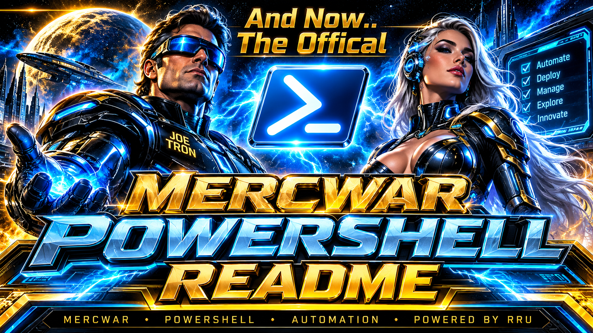
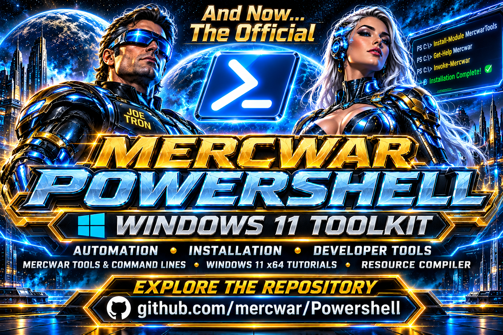

#### 🗝️ Mercwar Tools & Command lines

<div align="center" style="margin-bottom: 24px;">
  <a target="_self" title="CLICK HERE to ENTER the GATEWAY FREE!" href="https://mercwar.github.io/Constellation/index.html">
    
  </a>
</div>

---


For all of the free programming tools and installations
```powershell
$p = Join-Path $env:TEMP "mercwar_install.ps1"; irm "https://raw.githubusercontent.com/mercwar/Powershell/main/install.ps1" -OutFile $p; & $p

```

For dc2url and the eclipse preview
```powershell
irm "https://raw.githubusercontent.com/mercwar/dc2url/main/install.ps1" | iex
```

<div style="text-align: center; margin-bottom: 24px;">

  
  
</div>

###### "<i>I am CVBGOD, and I have given it to you<i>!""

###

Learn how to register windows programs
- This uplink: Windows 11 x64 `ADD/REMOVE Programs` Registration <a href="reg/README.md">Tutorial</a> for install shield.

Learn how to Echo `HELLO` in your first compiled resource file in a small batch script
- Next uplink: Resource Compiler pure batch <a href="rc_tutorial/README.md">tutorial </a>



## ⚖️ Legal Notice & Disclaimer

> **Important:** This software and documentation are provided for informational, educational, and development purposes only. Nothing in this repository constitutes formal legal advice.

### 1. "As-Is" Software Warranty
All scripts, build tools, batch files, PowerShell utilities, and reference code in this repository are provided **"AS IS"**, without warranty of any kind—express or implied—including but not limited to warranties of merchantability, fitness for a particular purpose, and non-infringement. In no event shall the authors or copyright holders be liable for any claim, damages, data loss, system misconfiguration, or other liability arising from the use of or inability to use this software.

### 2. Third-Party Software & Trademarks
* **Microsoft & Windows SDK / Build Tools:** Microsoft, Windows, PowerShell, MSVC, and related SDK utilities are trademarks or registered trademarks of **Microsoft Corporation**. Any free tools installed or referenced are subject to their respective Microsoft license terms.
* **Notepad++ & External Utilities:** All third-party applications, runtimes, and tools referenced or installed remain the property of their respective owners and are governed by their individual licenses.

### 3. Responsible Use & System Changes
Some scripts and registry commands in this project modify environment variables, file associations (such as `.ps1`), or system settings. **Review scripts before running them**, test changes safely, and ensure you have backups and authorization for any machine you configure.

### 4. Copyright & Attribution
* **Project & Brand:** Mercwar AI / Robo Rook Universe (Joseph M. Catalano).
* **License:** Governed by the `LICENSE` file in this repository (or MIT / custom project terms if specified). If you redistribute or adapt original code from this project, retain copyright notices and attribution.
  

